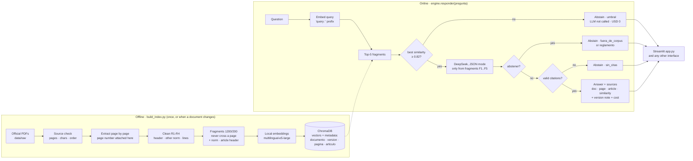
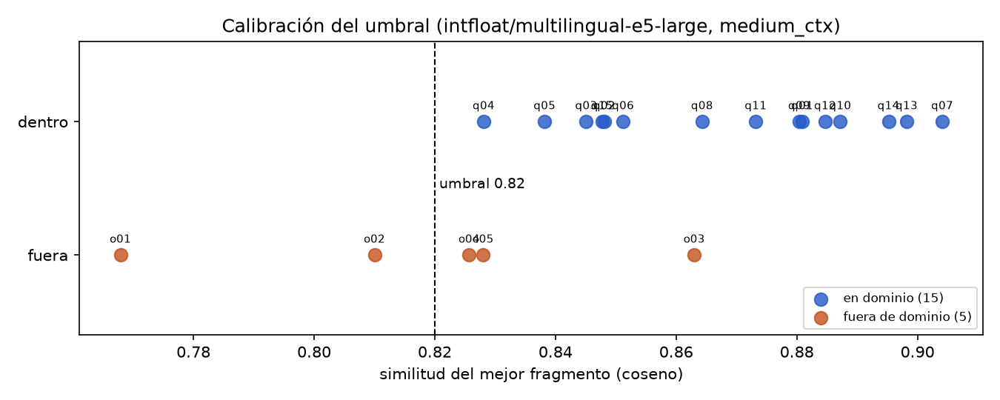

# Normative RAG and Public Procurement Radar

Two connected tools for a Peruvian small business (MYPE) that wants to sell to the State:

- **Task 1 — Normative RAG** (`tarea1_rag_normativo/`): answers "what does the law say?" only from the
  official texts, cites document and page, and abstains when the answer is not in the corpus.
- **Task 2 — Procurement Radar** (`tarea2_radar/`): "what is the State buying, and where?" over OECE
  open contracting data. *(in progress)*

Video: *(link added when recorded)*

---

## Task 1 · Normative RAG

**Headline.** With a local e5-large model and 1,200-character fragments that carry their norm and
article, the right page is among the top 5 fragments for **15/15** in-domain questions
(Recall@1 0.80, Recall@3 0.93). End to end the assistant makes **19/20 correct decisions**: it answers
14/15 in-domain questions, **every answer cites the expected page (14/14)**, and it abstains on
**5/5** out-of-domain questions — two before calling the LLM, three after the LLM found that the
fragments do not answer them (one correctly labelled "this is in the Reglamento"). A question costs
**about USD 0.0003**.

### Pipeline



### Architecture rules and how they are met

| Rule | How |
|---|---|
| Offline and online are separate | `build_index.py` writes the index; `src/engine.py` only reads it, never the PDFs |
| One engine, many interfaces | `engine.responder(pregunta)` returns `respuesta, fuentes[documento, pagina, articulo, similitud], abstuvo, motivo_abstencion, nota_version, tokens, costo_usd, franja_precio, error` |
| The engine knows no interface | `grep -rnE "^\s*(import\|from)\s+(streamlit\|telegram\|gradio)" tarea1_rag_normativo/src` → no output |
| Configuration outside the code | `tarea1_rag_normativo/config.yaml`: paths, sources, chunking, models, threshold, prompts, user messages, prices. Keys in `.env` (never committed; `.env.example` has names only) |
| Observable cost | every generation and embedding call is appended to `logs/calls.csv` (UTC time, model, tokens in/cached/out, latency, price window, USD, ok) |

### Phase 1 · Sources, extraction and cleaning

Source check, run before anything else (`src/source_check.py`):

| Document | Pages | Characters | Chars/page median (min–max) | Pages without text | Reading order | Usable as is |
|---|---|---|---|---|---|---|
| Ley N.° 32069 (text with amendments up to 2026-07-19) | 63 | 220,096 | 3,551 (1,238–4,273) | 0 | 0.990 | yes |
| DS N.° 001-2026-EF (modifies the Reglamento) | 16 | 112,477 | 6,977 (6,444–8,033) | 0 | 0.974 | yes |

*Reading order* = share of consecutive article headings in ascending order. The backward steps are
structural (final provisions citing other norms, the decree's own articles after the Reglamento
articles it quotes), not columns read in the wrong order.

Sources are official only, downloaded 2026-11-03 with URL and sha256 in `data/raw/sources.json`: the Ley
from the OECE collection on gob.pe; the decree from the MEF page on gob.pe because
`busquedas.elperuano.pe` refused connections that day (the gob.pe file is the El Peruano edition of
8 January 2026, gazette pages 33–48).

**Why page-level from the first step.** Each PDF page becomes one record with its page number before any
cleaning, and fragments are cut inside a page. Joining the whole document into one string and splitting
it later forces you to rebuild page boundaries from character offsets, and a fragment that straddles two
pages silently keeps only one of them — the citation is lost exactly where the answer is.

Cleaning rules (`src/extract.py`, report in `reports/extraction_quality.md` with before/after):

| Rule | What | Effect |
|---|---|---|
| R1 | El Peruano header ("33NORMAS LEGALESJueves 8 de enero de 2026 El Peruano /", glued on odd pages) removed; its number kept as `pagina_diario` | 16 headers, 912 chars |
| R2 | text after the decree's publication code `2474920-3` belongs to the next norm in the gazette | 6,270 chars of an unrelated MEF resolution dropped |
| R3 | PDF lines joined into paragraphs, except before Artículo / numeral / literal / CAPÍTULO / "(*)" markers; hyphenation repaired | — |
| R4 | whitespace normalized | — |

No page was discarded. **Corpus limit found while cleaning:** article 30 of the consolidated Ley
(*Impedimentos para contratar*) does not list the impediments; it links to an external PDF
("Enlace Web: Impedimentos para contratar (PDF)"). The assistant abstains on that question instead of
inventing the list.

### Phase 2 · Chunking, embeddings and index

- Fragment = paragraphs of **one page** packed up to `size` chars, long paragraphs split at sentence ends,
  `overlap` chars of whole sentences repeated. Metadata: `documento, titulo, tipo, version, fecha_version,
  pagina, pagina_diario, articulo, ambito (ley | reglamento)`.
- ID `<documento>:p<page>:c<n>`: unique across documents, stable between runs.
- **Idempotent / resumable / isolated** (`src/index.py`): upsert by ID, skip IDs whose hash of the
  embedded text is unchanged (a second run embeds 0 of 351), write batch by batch, delete stale IDs per
  document only. Proven in `logs/index_builds.csv`.
- **Model requirements.** multilingual-e5 is trained with the prefixes `query: ` / `passage: ` (applied in
  `src/embeddings.py`); max input 512 tokens. The largest fragment of the chosen config is 315 tokens
  (1800-char fragments reach 499, too close to the limit). Gemini takes a task type
  (RETRIEVAL_QUERY / RETRIEVAL_DOCUMENT) instead.
- **Contextual header.** The embedding input is `"<norm> · Artículo N. <title>\n<fragment>"`; the stored and
  shown text stays clean. A fragment from the middle of an article otherwise loses the only place its topic
  is named.

Fragments per document (chosen config `medium_ctx`): Ley 237, decree 114; length median 1,032 / 1,001
chars, p90 1,180 / 1,183 (`reports/chunk_stats.md`, `reports/figures/chunk_lengths.png`).

Chunking × model comparison on the evaluation set (retrieval only, no LLM):

| Model | Fragments | R@1 | R@3 | R@5 | MYPE R@3 | MYPE R@5 | ms/query |
|---|---|---|---|---|---|---|---|
| e5-base | small 700/120 | 0.60 | 0.80 | 0.87 | 0.40 | 0.60 | 45 |
| e5-base | medium 1200/200 | 0.73 | 0.87 | 0.87 | 0.60 | 0.60 | 30 |
| e5-base | large 1800/300 | 0.67 | 0.80 | 0.87 | 0.40 | 0.60 | 28 |
| e5-base | small + header | 0.80 | 0.87 | 0.87 | 0.60 | 0.60 | 26 |
| e5-large | medium | 0.80 | 0.87 | 0.93 | 0.60 | 0.80 | 52 |
| **e5-large** | **medium + header** | **0.80** | **0.93** | **1.00** | **0.80** | **1.00** | **51** |

With 15 questions one question = 0.067, so differences of one step are not significant; the choice rests
on R@5 = 1.00 (nothing the LLM needs is left out of its context) and on the colloquial questions.

### Phase 3 · Engine: threshold, versions, scope



- **Threshold 0.82, decided before the LLM.** No threshold separates the two groups: the out-of-domain
  "how much does RNP registration cost?" (0.863) scores above six valid questions. At 0.83 total errors
  fall to 2, but q04 ("¿Qué necesito para poder venderle al Estado?", 0.8281) is rejected 0.0001 above an
  out-of-domain question — a boundary that thin is noise. **0.82 loses no valid question** and stops the far
  ones (ceviche 0.77, UIT value 0.81) at cost 0. The trade-off is deliberate: a valid question wrongly
  rejected cannot be recovered, while an out-of-domain question that passes still meets a second filter.
  The cooking question scored 0.77 here (0.79 in the teaching team's test): cosine similarities are not
  intuitive and only a sweep shows where the groups sit (`reports/figures/threshold_sweep.png`).
- **Second filter: the LLM may abstain**, as a JSON field `{"abstener": true, "motivo": "fuera_de_corpus" |
  "reglamento"}`. Abstention is a structured field of the result (`abstuvo`, `motivo_abstencion`), never
  read from the answer text. An answer without valid `[F#]` citations is also turned into an abstention.
- **Versions.** Metadata separates the Ley (consolidated up to 2026-07-19) from the decree, which is not a
  law change but a partial rewrite of Reglamento articles (`ambito = reglamento`). The prompt makes the model
  say "según el Reglamento, modificado por el DS 001-2026-EF", and the engine adds a **deterministic
  version note** from the cited fragments' metadata, warning that the rest of the Reglamento is not indexed.
  Example: *"Soy una pequeña empresa, ¿pueden retenerme parte del pago en vez de pedirme una carta fianza?"*
  → cites Ley art. 61 (p. 29) and Reglamento art. 114.1 as modified (decree p. 14: for a MYPE the retention
  applies whatever the amount) and attaches both version notes.
- **Scope.** *"¿Cómo se calcula la penalidad diaria por mora según el Reglamento?"* passes the threshold
  (fragments about penalties exist) and the LLM abstains with motivo `reglamento`: the formula is in the
  Reglamento, which is not indexed.
- **Errors are errors.** Index missing or LLM failure → `error` field, shown with `st.error`, never as an answer.
- **Cost by time of day.** DeepSeek charges a peak rate (Mon–Fri 01–04 and 06–10 UTC) and an off-peak rate at
  half. `src/costs.py` picks the rate from each call's UTC time; prices verified 2026-11-03:

| Model (USD per 1M tokens) | input | input, cache hit | output | source |
|---|---|---|---|---|
| deepseek-flash, peak | 0.30 | 0.006 | 1.20 | api-docs.deepseek.com/quick_start/pricing |
| deepseek-flash, off-peak | 0.15 | 0.003 | 0.60 | same |
| gemini-embedding-001 (paid tier; free tier: 0) | 0.15 | — | — | ai.google.dev/gemini-api/docs/pricing |

### Phase 4 · Evaluation and embeddings comparison

`eval/preguntas.csv`: 15 in-domain questions with expected document and page (5 phrased as a MYPE owner
would, 4 on articles rewritten by the decree) and 5 out-of-domain (cooking; and four close to the domain:
UIT value, RNP fee, MYPE tax regime, the Reglamento's late-payment penalty formula).

- `eval/evaluate.py` — **Recall@k** measures the *retrieval* stage (is the right page in what the LLM will
  read?); the **abstention rate** measures the *decision* stage (right abstentions on out-of-domain, wrong
  ones on in-domain). Neither calls the LLM, so every chunking/model/threshold choice is re-checked for
  free on every change.
- `eval/evaluate_llm.py` — end to end through `responder()` (USD 0.0057 for the 20 questions).

| End to end | Result |
|---|---|
| Correct decisions | 19 / 20 |
| In-domain answered / wrongly abstained | 14 / 1 (q03: the fragment was in context; the LLM did not link "concurso" with "procedimiento de selección") |
| Answers citing the expected page | 14 / 14 |
| Out-of-domain abstained | 5 / 5 (2 by threshold, LLM not called; 2 fuera_de_corpus; 1 reglamento) |

**Embeddings comparison (same 351 fragments, `medium_ctx`).** The mandatory API model is OpenAI
`text-embedding-3-small`, but the course's OpenAI key was revoked (HTTP 401 on 2026-11-03), so the API
side uses **Gemini `gemini-embedding-001`** through the same interface (`embeddings.active: api`).
Switching back to OpenAI is a new class in `src/embeddings.py` and one config line.

| | Local · multilingual-e5-large | API · gemini-embedding-001 |
|---|---|---|
| Recall@1 / @3 / @5 | 0.80 / 0.93 / **1.00** | **0.87** / 0.93 / 0.93 |
| MYPE Recall@5 | **1.00** | 0.80 |
| Indexing time (351 fragments) | **12.6 s** (RTX 5050) | 281 s (9 HTTP 429 quota retries on the shared key) |
| Indexing cost | 0 | USD 0.014 (≈ 96 k tokens × 0.15 / M) |
| Query latency | **51 ms** | 640 ms |
| Vector dimension | 1,024 | 3,072 |
| Runs offline / data leaves the laptop | yes / no | no / yes |

**Choice: local.** Price does not decide it — re-embedding the whole corpus via API costs about one cent and a
query embedding a fraction of a thousandth of a cent, so both are free in practice. What differs is that the
API is 12× slower per query, stalls on quota limits (the build waited ~4 minutes on 429s), needs the network
and an account, and sends every user question to a third party, for no gain in recall@5. Note that similarity
scales differ (Gemini's in-domain minimum is 0.69): **the threshold must be recalibrated per model.**

### Phase 5 · Streamlit app

`tarea1_rag_normativo/app.py`: question box with examples, the answer or a highlighted abstention with its
motivo, cited fragments (document, article, page and gazette page, similarity), version note, cost, tokens and
price window; tabs with the source check and extraction report, the evaluation (Recall@k table, threshold sweep,
end-to-end) and the cost log. It loads the existing index and never rebuilds it.

### Run it (Windows)

```bat
:: 1. Python 3.11 environment (Miniconda/Anaconda Prompt)
conda create -n rag python=3.11 -y
conda activate rag
:: 2. PyTorch: GPU build (NVIDIA) ...
pip install torch --index-url https://download.pytorch.org/whl/cu128
::    ... or CPU only
pip install torch --index-url https://download.pytorch.org/whl/cpu
:: 3. Everything else
pip install -r requirements.txt
:: 4. Keys: copy .env.example to .env and fill DEEPSEEK_API_KEY (and GEMINI_API_KEY for the comparison)
copy .env.example .env
:: 5. Task 1
cd tarea1_rag_normativo
python src\download.py          & rem official PDFs (skips files already present)
python src\source_check.py      & rem source check table
python build_index.py           & rem offline: extract, clean, chunk, embed, index (13 s on an RTX 5050; longer on CPU)
python eval\evaluate.py         & rem Recall@k + threshold sweep, no LLM, free
streamlit run app.py
```

---

## Task 2 · Procurement Radar

*(in progress)*
