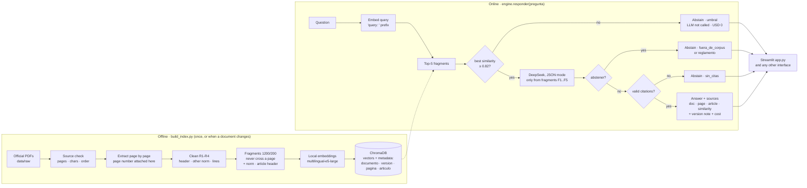
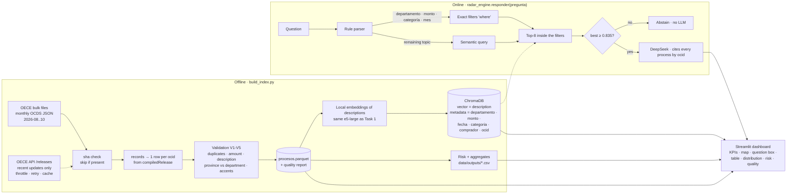

# Pipelines (used in the video)

Shown before any code: what happens once (offline) and what happens on every question (online).

## Task 1 · Normative RAG

The page number is metadata attached when each PDF page is read; the abstention decision is the diamond "best similarity ≥ 0.82", before the LLM.

## Task 2 · Procurement Radar

The department is metadata (from the buyer address, normalized to 25 departments); numbers and places become exact filters, only the topic is semantic.

